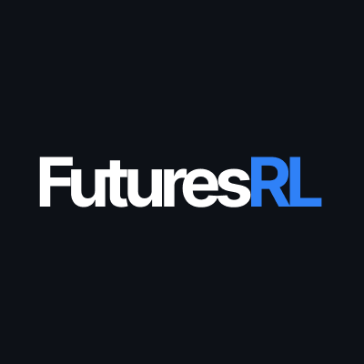

<p align="center">
  
</p>


<p align="center"><b>An AI-Native Modular Infrastructure for Quantitative Futures Trading</b></p>

<p align="center">
An algorithmic futures platform that unifies multi-timeframe market data,
LLM risk sentiment, composable strategy generation, walk-forward optimization, and
broker execution through a weight-centric interface.  
</p>

<p align="center">
  
  
</p>

<p align="center">
  <a href="#about">About</a> |
  <a href="#architecture">Architecture</a> |
  <a href="#quick-start">Quick Start</a> |
  <a href="#project-layout--documentation">Project Layout</a> |
  <a href="#acknowledgements--license">Acknowledgements</a>
</p>

---


## About

Inspired by [FinRL](https://github.com/AI4Finance-Foundation/FinRL-Trading)'s weight-centric architecture, FuturesRL is a modular research-to-execution platform for CME futures: a weight-centric strategy
pipeline, futures-native risk and contract translation, and one shared backtest/live path.

### Key Highlights

- **45+ CME futures across 7 sectors**, with automatic standard↔micro routing (`ES→MES`, `NQ→MNQ`, `CL→MCL`, `GC→MGC`).
- **Weight-centric composability**: swap universe selectors, classical allocators, DRL policies (`PPO`/`CPPO`/`SAC`/`TD3`), and timing overlays without touching risk or execution code.
- **Futures-native realism**: zero-lookahead continuous rolls, F1–F6 term structure, margin/cost simulation, and purged walk-forward validation.
- **Eight timeframes (`1m` to `1w`)**, cache-aware data management, and budgeted Databento/IBKR backfills.
- **Backtest-to-live parity**: the same `ContractTranslator` feeds the event-driven backtester and the IBKR OMS, with LLM and quantitative risk overlays in both paths.

---

FuturesRL leverages FinRL's weight-centric architecture translated into discrete, margin-constrained futures contracts:

$$w_t = \mathcal{R}_t \left( \mathcal{T}_t \left( \mathcal{A}_t \left( \mathcal{S}_t(X_{\le t}) \right) \right) \right) \implies N_{i,t} = \mathcal{C}_t(w_t, E_t, P_t, M, \text{IM})$$

Each transformation is contract-preserving — you can swap any module (e.g., risk-parity $\rightarrow$ DRL policy) without touching the rest of the pipeline, and the same weights flow identically through backtesting and live execution.

|Stage | Contract | What it does |
| --- | --- | --- |
| $\mathcal{S}$ | Universe selection | Filters liquid roots point-in-time by dollar volume, open interest and regime. |
| $\mathcal{A}$ | Portfolio allocation | Produces signed target weights $w$ via risk parity, vol targeting, mean-variance or DRL. |
| $\mathcal{T}$ | Timing & term structure | Scales weights with TSMOM, KAMA, carry/roll-yield and mean-reversion signals. |
| $\mathcal{R}$ | Risk overlays | Applies LLM Risk-First circuit breakers and deterministic quantitative limits. |
| $\mathcal{C}$ | Contract translation | Converts $w$ into discrete CME contracts with micro routing, FX normalization and margin checks. |

*Configured for Interactive Brokers (`ib_async`) and Databento (`GLBX.MDP3`), with full offline mode out of the box.*
## Architecture

```text
Data Layer  ──►  Strategy Layer  ──►  Execution & OMS Layer
Parquet/DuckDB    S_t → A_t → T_t → R_t        C_t → IBKR / simulated broker
8 timeframes      selectors, allocators,       pre-trade gate, whatIfOrder,
rolls/features    overlays, DRL (PPO/CPPO)     OMS, reconciler, telemetry
```

| Layer | Responsibility | Key modules |
| --- | --- | --- |
| Data | Point-in-time Parquet cache, 8-timeframe resampling, continuous rolls and features | `src/data/` |
| Strategy | Universe selection, allocation, timing overlays and PPO/CPPO DRL policies | `src/strategies/` |
| Risk & Translation | LLM Risk-First brake, quant limits and deterministic contract translation | `src/risk/` |
| Execution & OMS | Backtest/live parity, pre-trade margin gate, IBKR OMS and telemetry | `src/backtest/`, `src/execution/`, `src/api/` |

## Quick Start

```bash
git clone https://github.com/vidanmilenkovic/FuturesRL
cd FuturesRL
python3.12 -m venv .venv && source .venv/bin/activate
pip install -e ".[all]"
./scripts/dev.sh   # API :8000 · workstation :3100
```


## Project Layout & Documentation

```text
futuresrl/
├── configs/                     # Typed settings, 45-root instrument master, declarative strategies
│   ├── settings.py
│   ├── instruments.yaml
│   └── strategies/              # tsmom_vol_target.yaml, drl_ppo_llm_risk.yaml
├── src/
│   ├── core/                    # Immutable domain contracts, Protocols, async event bus
│   ├── data/                    # Databento/IBKR adapters, Parquet cache, rolls, 8 timeframes, features
│   ├── strategies/              # S_t selectors, A_t allocators, T_t overlays, DRL env/training
│   ├── risk/                    # LLM Risk-First, quant overlay, ContractTranslator, state store
│   ├── backtest/                # Event/vectorized engine, margin/cost simulators, walk-forward
│   ├── analytics/               # Institutional metrics, tearsheets, attribution
│   ├── execution/               # IBKR client/OMS, pre-trade gate, BAG rolls, reconciler, runner
│   └── api/                     # FastAPI app, domain routes, schemas, telemetry, services
├── frontend/                    # Next.js 15 workstation: Command Center, Pipeline, Risk, Studio
├── tests/                       # unit/, integration/, parity/ — hermetic, deterministic suites
├── docker/                      # Backend/frontend images and headless IB Gateway compose
├── docs/                        # USER_GUIDE.md, ARCHITECTURE.md, screenshots/
├── scripts/                     # quality_gate.sh, dev.sh, WSL/Windows host helper
├── CHANGELOG.md                 # Keep a Changelog + Semantic Versioning
├── CONTRIBUTING.md              # Setup, quality gate, architectural invariants, and PR rules
├── LICENSE                      # MIT
└── pyproject.toml               # Package metadata, extras, and CLI entry points
```


## Acknowledgements & License

The weight-centric abstraction is inspired by
**FinRL-X / FinRL-Trading** from the AI4Finance Foundation (Yang et al.,
*FinRL-X: An AI-Native Modular Infrastructure for Quantitative Trading*, [arXiv:2603.21330](https://arxiv.org/abs/2603.21330)).


Released under the **[MIT License](LICENSE)**.

**Disclaimer:** *Futures trading involves substantial leverage, margin calls, and risk of loss. FuturesRL is for educational and research purposes only and is not investment advice; backtest and paper results do not guarantee live performance. Use at your own risk.*
