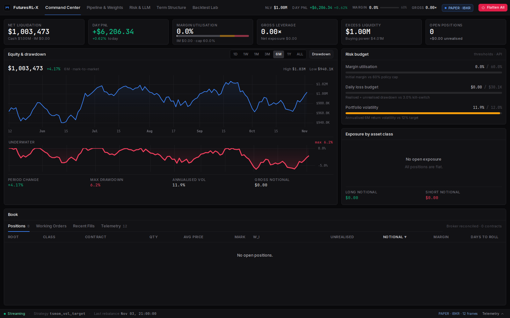
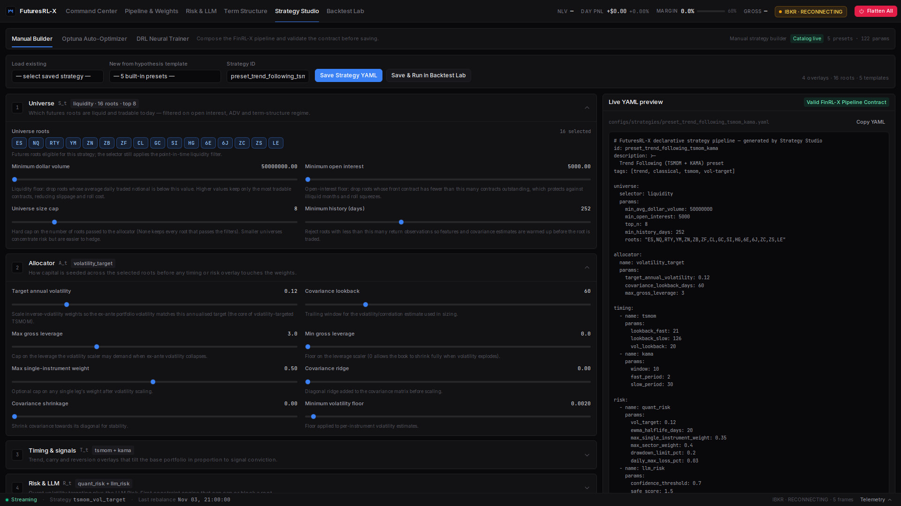

<p align="center">
  
</p>

<h1 align="center">FuturesRL-X</h1>

<p align="center"><b>An AI-Native Modular Infrastructure for Quantitative Futures Trading</b></p>

<p align="center">
A deployment-consistent algorithmic futures platform that unifies multi-timeframe market data,
continuous contract rolling, composable strategy generation, purged walk-forward optimization, and
IBKR paper/live execution through a single weight-centric contract.
</p>

<p align="center">
  
  
  
  
  
  
  
</p>

<p align="center">
  <a href="#architecture">Architecture</a> ·
  <a href="#why-futuresrl-x">Why FuturesRL-X?</a> ·
  <a href="#quick-start">Quick Start</a> ·
  <a href="#workstation-ui">Workstation UI</a> ·
  <a href="#strategy-use-cases">Strategy Use Cases</a> ·
  <a href="#python-api">Python API</a> ·
  <a href="#configuration">Configuration</a> ·
  <a href="#citation">Citation</a>
</p>

---

<a id="architecture"></a>

## Core Concept: Weight-Centric + Contract-Translated Architecture

FuturesRL-X adapts the FinRL-X weight-centric contract to leveraged, expiring futures. A strategy is
a composition of four contract-preserving stages; the only boundary between research, backtesting
and execution is the approved target-weight vector. A deterministic `ContractTranslator` then maps
continuous weights into discrete CME contracts.

```text
w_t = R_t( T_t( A_t( S_t( X_{≤t} ) ) ) )  ──►  N_{i,t} = C_t( w_t, E_t, P_t, M, IM )
        │       │       │       │                        │
        │       │       │       └── S_t  Universe Selection (liquidity, OI, regime)
        │       │       └────────── A_t  Portfolio Allocation (vol target, risk parity, MV, DRL)
        │       └────────────────── T_t  Timing & Term Structure (TSMOM, KAMA, carry, mean-rev, seasonality)
        └────────────────────────── R_t  Risk Overlays (LLM Risk-First circuit breaker, quant hard caps)
                                                         └── C_t  ContractTranslator (standard↔micro routing, η_max ≤ 60% margin ceiling)
```

- **Contract-preserving composability.** Swap any universe selector, classical allocator, or
  Stable-Baselines3 policy (PPO / CPPO / SAC / TD3 / A2C) without touching downstream risk,
  portfolio-construction, or execution code.
- **Futures-native discretization.** `ContractTranslator` converts continuous signed weights `w_t`
  into integer contracts with FX base-currency normalization, automatic standard-to-micro spillover
  (`ES→MES`, `NQ→MNQ`, `CL→MCL`, `GC→MGC`) and a mathematical initial-margin ceiling (`η_max = 0.60`).
- **Zero backtest-to-live drift.** Identical `MarketState` inputs produce bit-for-bit identical
  `ContractTargetSet` deltas in the event-driven backtester and the live IBKR Order Management System,
  enforced by `tests/parity/`.

| Layer | Responsibility | Key components |
| --- | --- | --- |
| **Data** | Point-in-time bars, contract metadata, rolls and cache | Databento + IBKR adapters, canonical Polars/Parquet schema, 8-timeframe resampler, continuous roller, feature processor |
| **Strategy** | `S_t → A_t → T_t` weight construction | Liquidity/regime selectors, risk-parity/vol-target/mean-variance/DRL allocators, TSMOM/KAMA/carry/mean-reversion overlays |
| **Risk & Translation** | `R_t` approval and `C_t` contract mapping | LLM Risk-First circuit breaker, quant limits, EWMA covariance, deterministic `ContractTranslator` |
| **Backtest & Optimization** | Event/vectorized simulation and OOS search | Event-driven engine, margin/cost/roll simulators, purged & embargoed walk-forward, Optuna |
| **Execution & Telemetry** | Broker parity and operator visibility | IBKR OMS + `whatIfOrder`, reconciler, kill switch, runner bridge, FastAPI + Next.js |

## Why FuturesRL-X?

| Capability | Backtrader / Zipline | Classic DRL repos | FinRL-Trading (Equities) | FuturesRL-X (Futures) |
| --- | --- | --- | --- | --- |
| **Primary asset class** | Equities | Mixed / equities | Equities | **45+ CME leveraged futures across 7 sectors** |
| **Interface contract** | Ad-hoc signals | Raw gym actions | Weight vector `w_t` | **Weight vector `w_t` + discrete `ContractTranslator` `N_{i,t}`** |
| **Continuous contract rolling** | Manual | Rarely handled | Not applicable | **Zero-lookahead Panama, proportional and unadjusted + explicit F1–F6 carry** |
| **Multi-timeframe support** | Fixed bar source | Fixed environment | Fixed daily bars | **1m, 5m, 15m, 30m, 1h, 4h, 1d, 1w with dynamic `√N` annualization** |
| **Standard ↔ micro routing** | None | None | None | **Automatic ES↔MES, NQ↔MNQ, CL↔MCL, GC↔MGC** |
| **Pre-trade & semantic risk** | None / basic | None | Basic portfolio constraints | **LLM anti-hallucination + post-hoc circuit breaker + IBKR `whatIfOrder` margin gate** |
| **Hyperparameter optimization** | In-sample grid | Manual tuning | In-sample grid | **Purged & embargoed walk-forward Optuna OOS optimizer** |

## Annotated Repository Structure

```text
futuresrl-x/
├── ⚙️ configs/                     # typed settings, 45-root instrument master, declarative strategies
│   ├── settings.py
│   ├── instruments.yaml
│   └── strategies/                 # tsmom_vol_target.yaml, drl_ppo_llm_risk.yaml
├── 🗄️ src/data/                    # Databento/IBKR adapters, Parquet cache, rolls, 8 timeframes, features
├── 🧠 src/strategies/              # S_t selectors, A_t allocators, T_t overlays, DRL env/training
├── 🛡️ src/risk/                    # LLM Risk-First, quant overlay, ContractTranslator, state store
├── 📊 src/backtest/                # event/vectorized engine, margin/cost simulators, walk-forward
├── 📈 src/analytics/               # institutional metrics, tearsheets, attribution
├── ⚡ src/execution/                # IBKR client/OMS, pre-trade gate, BAG rolls, reconciler, runner
├── 🌐 src/api/                     # FastAPI app, domain routes, schemas, telemetry, services
├── 🖥️ frontend/                    # Next.js 15 workstation: Command Center, Pipeline, Risk, Studio
├── 🧪 tests/                       # unit/, integration/, parity/ — hermetic, deterministic suites
├── 🐳 docker/                      # backend/frontend images, TimescaleDB/Redis/IB Gateway compose
├── 📚 docs/                        # USER_GUIDE.md, ARCHITECTURE.md, screenshots/
├── scripts/                        # quality_gate.sh, dev.sh, WSL/Windows host helper
├── CHANGELOG.md                    # Keep a Changelog + Semantic Versioning
├── CONTRIBUTING.md                 # setup, quality gate, architectural invariants and PR rules
├── LICENSE                         # MIT
└── pyproject.toml                  # package metadata, extras and CLI entry points
```

## Quick Start

### Option A — One-command full-stack launch

```bash
git clone https://github.com/<your-org>/futuresrl-x.git
cd futuresrl-x
python3.12 -m venv .venv
source .venv/bin/activate
pip install -e ".[all]"

./scripts/dev.sh        # or: make dev
```

`dev.sh` creates `.env` from `.env.example` when needed, then starts the FastAPI backend on
**http://127.0.0.1:8000** and the Next.js workstation on **http://127.0.0.1:3100** with clean
`SIGINT`/`SIGTERM` shutdown. The default configuration runs deterministically offline — **no API
keys and no broker connection are required** to explore the platform.

### Option B — CLI entry points

Installing the package exposes first-class commands:

```bash
futuresrlx-api                         # FastAPI backend (uvicorn)
futuresrlx-backtest --strategy configs/strategies/tsmom_vol_target.yaml --offline
futuresrlx-optimize --strategy configs/strategies/tsmom_vol_target.yaml --trials 25 --objective sharpe --offline
futuresrlx-train-drl --strategy configs/strategies/drl_ppo_llm_risk.yaml --timesteps 20000 --offline
futuresrlx-runner --check              # validate settings, instruments, strategy and hydration config
futuresrlx-runner --strategy configs/strategies/tsmom_vol_target.yaml --roots ES,NQ,CL,GC,ZN --rebalance-once --dry-run
```

### Option C — Docker Compose stack

```bash
docker compose -f docker/docker-compose.yml up --build
```

The compose stack starts TimescaleDB, Redis, a headless IB Gateway (paper), the FastAPI backend and
the Next.js workstation. Set `FUTURESRLX_API_ENABLE_IBKR=1` in `docker/.env` to attach a live IBKR
paper session; otherwise the stack runs in offline/deterministic mode.

<a id="workstation-ui"></a>

## Workstation UI Showcase

<table>
  <tr>
    <td width="50%" align="center"></td>
    <td width="50%" align="center"></td>
  </tr>
  <tr>
    <td align="center"><sub><b>Command Center</b> — live NLV, margin budget, positions, risk drawer and guarded flatten/reset controls.</sub></td>
    <td align="center"><sub><b>Strategy Studio</b> — 45-root universe, sector filters, stage switcher and declarative preview.</sub></td>
  </tr>
  <tr>
    <td width="50%" align="center"></td>
    <td width="50%" align="center"></td>
  </tr>
  <tr>
    <td align="center"><sub><b>Manual Builder</b> — compose selectors, allocators, overlays and risk stages with an editable YAML contract.</sub></td>
    <td align="center"><sub><b>Optuna Auto-Optimizer</b> — purged/embargoed OOS trials, activity-guarded best selection and live provenance.</sub></td>
  </tr>
</table>

The workstation follows the six core views: **Command Center** (live/paper telemetry), **Pipeline &
Weights** (the `S → A → T → R → N` waterfall), **Risk & LLM** (semantic assessments and breaker
state), **Term Structure** (F1–F6 curves and roll calendar), **Strategy Studio** (manual and Optuna
workflows), and **Backtest Lab** (walk-forward/diagnostic tear sheets and comparisons).

<a id="strategy-use-cases"></a>

## Composable Strategy Use Cases

### Use Case 1 — Volatility-targeted time-series momentum + carry filter

`configs/strategies/tsmom_vol_target.yaml` runs a classical multi-sector TSMOM book with KAMA
confirmation, a carry/term-structure filter, and both quantitative and LLM risk overlays.

| Component | Implementation |
| --- | --- |
| Universe `S_t` | Liquidity selector with explicit root allow-list and sector caps |
| Allocation `A_t` | Volatility target with EWMA covariance and gross-leverage ceiling |
| Timing `T_t` | TSMOM (fast/slow), KAMA confirmation, carry filter |
| Risk `R_t` | Quant trailing stop/vol target + LLM Risk-First circuit breaker |
| Translation `C_t` | Discrete contracts, micro routing, 60% margin ceiling |

```bash
futuresrlx-backtest --strategy configs/strategies/tsmom_vol_target.yaml --offline --walk-forward --html reports/tsmom_walk_forward.html
```

### Use Case 2 — Risk-constrained DRL + LLM Risk-First circuit breaker

`configs/strategies/drl_ppo_llm_risk.yaml` binds a Stable-Baselines3 policy to the futures
environment while keeping the deterministic risk overlay and semantic circuit breaker in the loop.

| Component | Implementation |
| --- | --- |
| Universe `S_t` | Regime selector with crypto/agri options and top-N cap |
| Allocation `A_t` | PPO or CPPO policy trained on `FuturesTradingEnv` (SAC/TD3/A2C also supported) |
| Timing `T_t` | Optional TSMOM/KAMA overlay for policy stabilization |
| Risk `R_t` | LLM confidence filter, deterministic breaker, quant hard limits |
| Translation `C_t` | Same `ContractTranslator` and pre-trade margin gate used by classical books |

```bash
futuresrlx-train-drl --strategy configs/strategies/drl_ppo_llm_risk.yaml --algorithm CPPO --timesteps 20000 --offline --checkpoint-name cppo_llm_risk
futuresrlx-runner --strategy configs/strategies/drl_ppo_llm_risk.yaml --check
```

### Use Case 3 — Purged walk-forward Optuna + multi-timeframe resampling

Optimize a strategy strictly on out-of-sample folds, then run the same configuration across intraday
or weekly bars. The data layer auto-resamples finer cached Parquet (1m→5m/15m/30m/1h, 1h→4h,
1d→1w) and annualizes metrics with the matching trading-bar count.

| Component | Implementation |
| --- | --- |
| Search | Optuna TPE with deterministic LHS fallback, activity-penalized objectives |
| Validation | Purged + embargoed walk-forward, OOS-only best-trial selection |
| Data | Parquet cache with cost-guarded Databento/IBKR backfills and provenance |
| Timeframes | 1m, 5m, 15m, 30m, 1h, 4h, 1d, 1w with `bars_per_year` annualization |
| Artifacts | Persisted studies, verification backtests and apply-to-strategy workflow |

```bash
futuresrlx-optimize --strategy configs/strategies/tsmom_vol_target.yaml --trials 40 --objective sharpe --splits 5 --offline
```

<a id="python-api"></a>

## Python API & Extending the Pipeline

The pipeline is importable and testable without the dashboard. The 25-line program below loads a
declarative strategy, implements a protocol-compatible timing overlay, runs a deterministic
backtest, and verifies the accounting identity:

```python
from datetime import UTC, datetime

from configs.instruments import load_instruments
from configs.strategy import load_strategy_config
from src.backtest.engine import build_states_from_bars, run_from_config
from src.core.interfaces import TimingOverlay
from src.core.types import MarketState, WeightVector
from src.data.databento_loader import OfflineBarSource

class NoopTiming:
    """Protocol-compatible T_t overlay: pass through allocator weights."""

    name = "noop"

    def adjust_timing(self, weights: WeightVector, state: MarketState) -> WeightVector:
        return weights

config = load_strategy_config("configs/strategies/tsmom_vol_target.yaml")
master = load_instruments()
source = OfflineBarSource(roots=("ES", "NQ", "CL", "GC", "ZN"), periods=600)
bars = source.load(source.roots, datetime(2024, 1, 2, tzinfo=UTC), datetime(2025, 1, 2, tzinfo=UTC))
states = build_states_from_bars(bars, master, initial_equity=1_000_000)
result = run_from_config(config, states=states, instrument_master=master)
result.check_accounting_identity()
assert isinstance(NoopTiming(), TimingOverlay)
```

For production composition, use `src.strategies.pipeline.build_pipeline` with the same config and
inject custom stages through their registries. The protocol definitions live in
`src/core/interfaces.py`; a custom allocator implements `allocate(candidates, state)` and a custom
timing overlay implements `adjust_timing(weights, state)`.

## Configuration

Runtime settings are Pydantic settings loaded from environment variables or `.env`; never commit
`.env` or credentials.

| Variable | Purpose | Default |
| --- | --- | --- |
| `FUTURESRLX_ENVIRONMENT` | `backtest` / `paper` / `live` execution mode | `backtest` |
| `FUTURESRLX_DATABENTO_API_KEY` | Databento historical data access | empty |
| `FUTURESRLX_DATABENTO_MAX_COST_USD_PER_JOB` | Hard per-job Databento cost guard | `2.00` |
| `FUTURESRLX_IBKR_HOST` / `_PORT` / `_CLIENT_ID` | TWS/IB Gateway connection | `127.0.0.1` / `7497` / `42` |
| `FUTURESRLX_IBKR_PAPER` | Paper (`true`) vs live (`false`) account | `true` |
| `FUTURESRLX_ACCOUNT_CURRENCY` | Broker account base currency | `USD` |
| `FUTURESRLX_FX_RATES` | JSON FX table for non-USD NLV normalization | `{}` |
| `FUTURESRLX_LLM_PROVIDER` / `_MODEL` / `_API_KEY` | LLM Risk-First provider | `offline` / `gpt-4o-mini` / empty |
| `FUTURESRLX_RUNNER_BRIDGE_ENABLED` | Publish runner snapshots to the dashboard | `true` |
| `FUTURESRLX_IBKR_MARKET_DATA_TYPE` | IBKR market-data type (`1` live … `3` delayed) | `3` |

## Quality Gates

Every change must pass the hermetic quality gate:

```bash
./scripts/quality_gate.sh --cov
cd frontend && npm run build && npm run lint
```

The gate runs `ruff check`, `ruff format --check`, strict `mypy`, the full deterministic test suite,
and an 85% coverage floor. Tests never require TWS, paid market data, network access, or a populated
cache.

## Acknowledgements

FuturesRL-X is inspired by **FinRL-X / FinRL-Trading** from the
[AI4Finance Foundation](https://github.com/AI4Finance-Foundation), especially the weight-centric
composable `S → A → T → R` abstraction:

> Yang et al., *FinRL-X: An AI-Native Modular Infrastructure for Quantitative Trading*,
> arXiv:2603.21330.

The portfolio-construction and risk design also draw on Grinold & Kahn, *Active Portfolio Management*
(1999), and López de Prado, *Advances in Financial Machine Learning* (2018).

## Citation

If you use FuturesRL-X in research, please cite the project and its lineage:

```bibtex
@misc{futuresrlx2026,
  title  = {FuturesRL-X: An AI-Native Modular Infrastructure for Quantitative Futures Trading},
  author = {{FuturesRL-X Contributors}},
  year   = {2026},
  url    = {https://github.com/<your-org>/futuresrl-x}
}

@misc{finrlx2026,
  title        = {FinRL-X: An AI-Native Modular Infrastructure for Quantitative Trading},
  author       = {{AI4Finance Foundation}},
  year         = {2026},
  eprint       = {2603.21330},
  archivePrefix = {arXiv}
}
```

## Disclaimer

FuturesRL-X is provided for **educational and research purposes only**. It is not investment advice,
a solicitation, or a guarantee of performance. Futures trading involves substantial leverage,
margin calls, liquidity risk and the potential loss of more than the initial deposit. Backtest,
paper and simulated results do not guarantee live results. You are solely responsible for regulatory
compliance, broker permissions, risk limits and any capital deployed. Use at your own risk.
