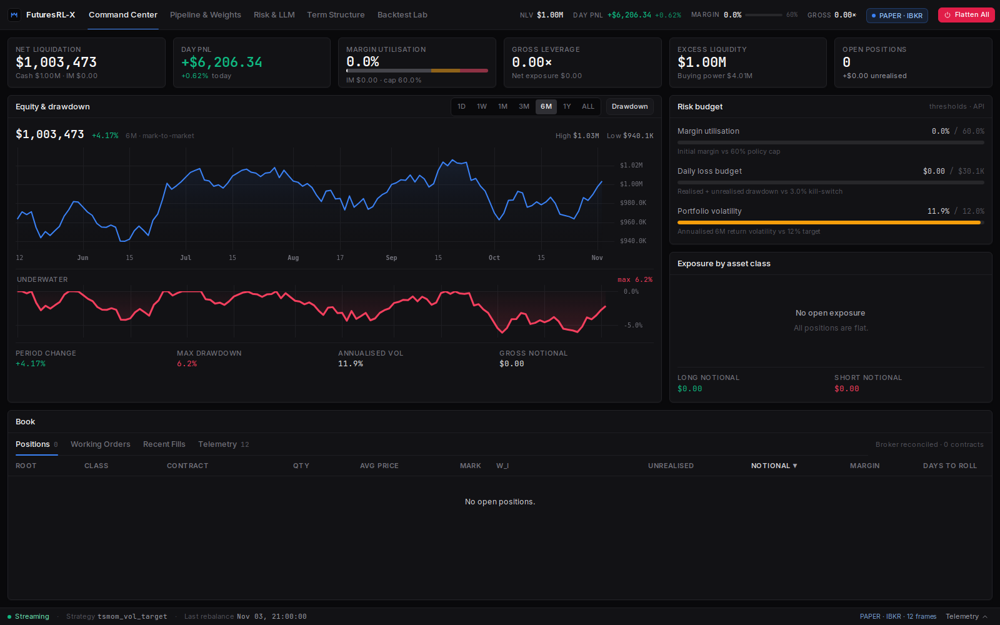
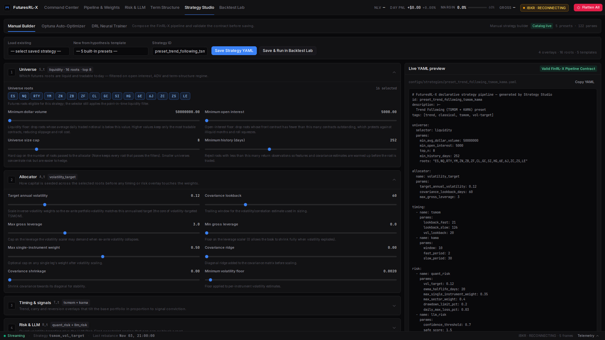
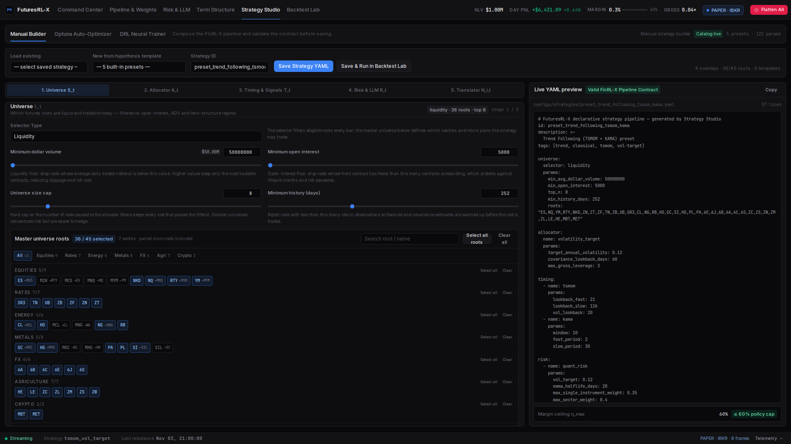
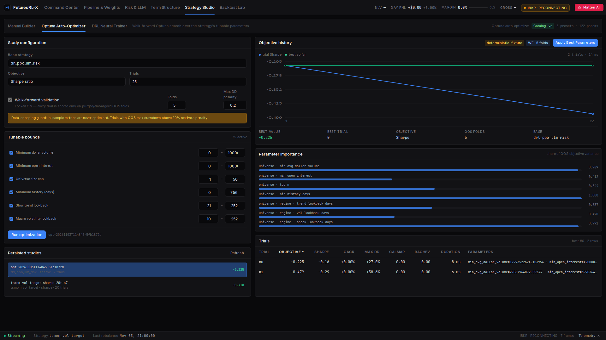

# FuturesRL-X — User Guide

**How to install, run, configure, and operate the platform** — including Databento historical data, IBKR paper/live trading, the dashboard, and the backtest/risk CLIs.

> FuturesRL-X is research and execution infrastructure, **not investment advice**. Futures are leveraged; you can lose more than your initial margin. Paper-trade and run a full backtest before risking live capital.

---

## Table of contents

1. [What you get](#1-what-you-get)
2. [Prerequisites](#2-prerequisites)
3. [Install](#3-install)
4. [Quick start: run the app](#4-quick-start-run-the-app)
5. [Configuration (`.env` / `FUTURESRLX_*`)](#5-configuration)
6. [Data sources: Databento, IBKR, offline](#6-data-sources)
7. [IBKR broker setup (paper & live)](#7-ibkr-broker-setup)
8. [Running backtests](#8-running-backtests)
9. [Running live / paper trading](#9-running-live--paper-trading)
10. [Operating the risk system](#10-operating-the-risk-system)
11. [Docker deployment](#11-docker-deployment)
12. [Quality gate, tests & CI](#12-quality-gate-tests--ci)
13. [Troubleshooting](#13-troubleshooting)
14. [Security & safety notes](#14-security--safety-notes)

---

## 1. What you get

| Component | Entry point | Purpose |
|---|---|---|
| FastAPI telemetry backend | `python -m uvicorn src.api.main:app` | REST + `/ws/telemetry` for positions, pipeline, risk, term structure, backtests |
| Next.js dashboard | `cd frontend && npm run dev` | 5-view quant workstation (Command Center, Pipeline & Weights, Risk & LLM, Term Structure, Backtest Lab) on port **3100** |
| Backtest CLI | `python -m src.backtest.engine` | Declarative strategy backtests + walk-forward validation + tear sheets |
| Live runner | `python -m src.execution.runner` | Cold-start hydration → pipeline → OMS → IBKR paper/live (or `--offline` dry run) |
| Quality gate | `./scripts/quality_gate.sh --cov` | ruff + format + strict mypy + pytest + coverage |

Everything is **offline-capable**: with no credentials the API/dashboard/backtests run on deterministic fixture data, and the runner can be exercised end-to-end with `--offline`.

---

## 2. Prerequisites

- **Python ≥ 3.12** (the reference environment is 3.14)
- **Node.js ≥ 20** (dashboard; reference: Node 22)
- Optional: **IBKR TWS or IB Gateway** for paper/live trading
- Optional: **Databento account/API key** for real historical data
- Optional: **Docker + Compose** for the containerised stack

---

## 3. Install

### Fresh clone

```bash
git clone <your-repo-url> futures-app && cd futures-app

python3 -m venv .venv
.venv/bin/pip install --upgrade pip
.venv/bin/pip install -e ".[dev]"          # core + test/lint/type tooling

# optional extras
.venv/bin/pip install -e ".[live]"         # ib_async (IBKR paper/live)
.venv/bin/pip install -e ".[databento]"    # Databento SDK
.venv/bin/pip install -e ".[drl]"          # gymnasium + stable-baselines3/torch

cd frontend && npm install && cd ..
cp .env.example .env                       # then edit
```

### This workspace (already installed)

`/home/vidan/futures-app` already has `.venv/` and `frontend/node_modules/`; you can skip the install step and go straight to [Quick start](#4-quick-start-run-the-app).

Verify everything:

```bash
./scripts/quality_gate.sh --cov
```

---

## 4. Quick start: run the app

Two terminals:

```bash
# Terminal 1 — backend on :8000 (offline/deterministic by default)
cd /home/vidan/futures-app
.venv/bin/python -m uvicorn src.api.main:app --host 127.0.0.1 --port 8000

# Terminal 2 — dashboard on :3100
cd /home/vidan/futures-app/frontend
npm run dev            # dev server
# or: npm run build && npm run start   (production build)
```

Open **http://localhost:3100**.

| Route | View |
|---|---|
| `/` | Command Center — NLV, intraday PnL, margin utilisation, equity curve, positions, flatten-all |
| `/pipeline` | Pipeline & Weights — `S_t → A_t → T_t → R_t → N_i,t` waterfall + per-root transformation matrix |
| `/risk` | Risk & LLM Monitor — semantic risk, confidence, circuit breaker, macro lockouts, thresholds |
| `/term-structure` | Term Structure & Roll Calendar — forward curves, basis, roll schedule |
| `/backtests` | Backtest Lab — run/compare backtests, tear sheets, rolling Sharpe, Rachev tails |

**Data mode.** The dashboard reads `/health.offline_mode`:
- `DEMO DATA` badge → backend not running (pure deterministic mock fixtures).
- backend running with `offline_mode: true` → real pipeline/broker simulation on fixture market data (no paid vendors).
- `PAPER · IBKR` / `LIVE · IBKR` → backend attached to a real IBKR session (`FUTURESRLX_API_ENABLE_IBKR=1`).

Frontend/API base URL is `NEXT_PUBLIC_API_BASE_URL` (default `http://127.0.0.1:8000`); WebSocket `/ws/telemetry` is derived from it. The API's default CORS allow-list includes the dashboard origins `http://localhost:3100`, `http://127.0.0.1:3100`, `http://localhost:3080`, `http://127.0.0.1:3080` (and legacy 3000).

The ribbon shows a **three-state data-mode badge**:
- `UI FALLBACK` (amber) — the FastAPI backend is unreachable; the dashboard renders deterministic
  fixtures for preview only.
- `OFFLINE ENGINE` (zinc/blue) — connected to FastAPI running with `offline_mode=true`
  (real pipeline/broker simulation on fixture market data).
- `PAPER · IBKR` (blue) / `LIVE · IBKR` (emerald) — connected to an IBKR paper/live session
  (`ibkr_connected=true` plus the API `environment`).

On the Command Center equity chart, daily timeframes (`1W/1M/3M/6M/1Y/ALL`) update the latest daily
bar in place when live `/ws/telemetry` ticks arrive; only the `1D` timeframe appends intraday points.

Stop servers with `Ctrl-C` in each terminal.

---

## 5. Configuration

### How configuration loads

`configs/settings.py` (pydantic-settings) reads, in order of precedence:

1. **Environment variables** `FUTURESRLX_*`
2. **`.env`** in the repo root (gitignored)
3. Defaults in `Settings` / `RiskSettings`

Secrets (`FUTURESRLX_DATABENTO_API_KEY`, IBKR account) are `SecretStr` values, redacted from logs/telemetry. **Never commit `.env`** and never put real keys in `.env.example`.

Nested risk settings use a double underscore: `FUTURESRLX_RISK__MAX_MARGIN_UTILIZATION=0.5`.

### Settings reference

#### Application & data

| Variable | Default | Meaning |
|---|---|---|
| `FUTURESRLX_ENVIRONMENT` | `development` | `development` / `paper` / `live` / `backtest` (paper/live enforce matching IBKR ports) |
| `FUTURESRLX_LOG_LEVEL` | `INFO` | Python log level |
| `FUTURESRLX_DATA_DIR` | `./data` | writable data root |
| `FUTURESRLX_PARQUET_DIR` | `./data/parquet` | partitioned Parquet cache |
| `FUTURESRLX_DUCKDB_PATH` | `./data/futuresrl_x.duckdb` | DuckDB file (analytics + optional risk state) |
| `FUTURESRLX_REPORT_DIR` | `./artifacts` | backtest/tear-sheet output |
| `FUTURESRLX_INSTRUMENTS_PATH` | `configs/instruments.yaml` | instrument master override |
| `FUTURESRLX_DATABENTO_API_KEY` | _(unset)_ | Databento key (secret) |
| `FUTURESRLX_DATABENTO_DATASET` | `GLBX.MDP3` | Databento dataset (CME/CBOT/NYMEX/COMEX) |
| `FUTURESRLX_DATABENTO_DEFAULT_SCHEMA` | `ohlcv-1d` | default bar schema |
| `FUTURESRLX_DATABENTO_LIVE_ENABLED` | `false` | Databento live feed (off by default) |

#### IBKR

| Variable | Default | Meaning |
|---|---|---|
| `FUTURESRLX_IBKR_HOST` | `127.0.0.1` | TWS/IB Gateway host |
| `FUTURESRLX_IBKR_PORT` | `7497` | paper TWS `7497`, paper Gateway `4002`, live TWS `7496`, live Gateway `4001` |
| `FUTURESRLX_IBKR_CLIENT_ID` | `42` | API client id (unique per session) |
| `FUTURESRLX_IBKR_PAPER` | `true` | must be `false` with a live port |
| `FUTURESRLX_IBKR_ACCOUNT` | _(unset)_ | optional account filter |
| `FUTURESRLX_IBKR_CONNECT_TIMEOUT_SECONDS` | `10` | connect timeout |
| `FUTURESRLX_IBKR_RECONNECT_MAX_ATTEMPTS` | `10` | reconnect attempts with exponential backoff |
| `FUTURESRLX_IBKR_NIGHTLY_RESET_START_HOUR_ET` / `END_HOUR_ET` | `23` / `0` | IBKR nightly reset window (pins `:45` boundaries) |

#### Risk engine

| Variable | Default | Meaning |
|---|---|---|
| `FUTURESRLX_RISK__MAX_MARGIN_UTILIZATION` | `0.60` | hard initial-margin ceiling `η_max` |
| `FUTURESRLX_RISK__MARGIN_WARNING_THRESHOLD` / `MARGIN_CRITICAL_THRESHOLD` | `0.60` / `0.80` | dashboard gauge zones |
| `FUTURESRLX_RISK__TARGET_ANNUAL_VOLATILITY` | `0.12` | ex-ante vol target |
| `FUTURESRLX_RISK__MAX_GROSS_LEVERAGE` | `3.0` | gross leverage cap |
| `FUTURESRLX_RISK__MAX_SINGLE_INSTRUMENT_WEIGHT` / `MAX_SECTOR_WEIGHT` | `0.50` / `0.40` | concentration caps |
| `FUTURESRLX_RISK__DAILY_MAX_LOSS_PCT` | `0.03` | intraday kill switch |
| `FUTURESRLX_RISK__TRAILING_STOP_PCT` / `DRAWDOWN_LIMIT_PCT` | `0.10` / `0.20` | HWM stops |
| `FUTURESRLX_RISK__LLM_CONFIDENCE_THRESHOLD` | `0.70` | `τ` anti-hallucination threshold |
| `FUTURESRLX_RISK__LLM_SAFE_SCORE` / `LLM_CRITICAL_SCORE` | `1.5` / `4.5` | `θ_safe` / `κ` |
| `FUTURESRLX_RISK__LLM_SAMPLE_COUNT` | `3` | K samples for confidence/variance filter |
| `FUTURESRLX_RISK__LLM_CACHE_TTL_SECONDS` | `60` | async LLM assessment cache TTL |
| `FUTURESRLX_RISK__MACRO_LOCKOUT_MINUTES_BEFORE` / `AFTER` | `30` / `30` | Tier-1 event lockout window |
| `FUTURESRLX_RISK__MAX_ORDER_CONTRACTS` | `200` | fat-finger limit per order |
| `FUTURESRLX_RISK__ORDER_RATE_LIMIT_PER_SECOND` | `5` | token-bucket rate |
| `FUTURESRLX_RISK__DUPLICATE_ORDER_WINDOW_SECONDS` | `1.0` | duplicate suppression window |
| `FUTURESRLX_RISK__RECONCILE_GRACE_SECONDS` | `30` | open-order grace before drift halt |
| `FUTURESRLX_RISK__RECONCILIATION_INTERVAL_SECONDS` | `30` | reconciler period |

#### Live news, LLM provider & runner bridge (Phase 9)

| Variable | Default | Meaning |
|---|---|---|
| `FUTURESRLX_LLM_PROVIDER` | `offline` | `offline` (deterministic fixtures) / `openai` / `anthropic` / `deepseek` / `gemini` / `vllm` |
| `FUTURESRLX_LLM_MODEL` | `gpt-4o-mini` | model identifier passed to the provider adapter |
| `FUTURESRLX_LLM_BASE_URL` | _(empty)_ | optional custom endpoint (vLLM / OpenAI-compatible proxy); empty = adapter default |
| `FUTURESRLX_LLM_API_KEY` | _(unset)_ | provider API key (secret; required for non-offline providers) |
| `FUTURESRLX_NEWS_RSS_FEEDS` | `[]` | JSON list of financial RSS/Atom feed URLs |
| `FUTURESRLX_NEWS_MAX_ITEMS` | `20` | max headlines per fetch |
| `FUTURESRLX_NEWS_POLL_INTERVAL_SECONDS` | `300` | background news refresh cadence in the API |
| `FUTURESRLX_RUNNER_BRIDGE_ENABLED` | `true` | publish runner snapshots to `data/bridge/runner_state.json` |

#### Account currency / FX

| Variable | Default | Meaning |
|---|---|---|
| `FUTURESRLX_ACCOUNT_CURRENCY` | `USD` | IBKR base currency; `MarketState.equity` is denominated in it |
| `FUTURESRLX_FX_RATES` | `{}` | JSON `{"EUR": 1.10}` = USD per 1 unit of currency (USD implicit 1.0) |

For a non-USD IBKR account, set both, e.g. `FUTURESRLX_ACCOUNT_CURRENCY=EUR` and `FUTURESRLX_FX_RATES='{"EUR": 1.10}'`. The translator converts `E_t` to USD before sizing; a missing rate fails closed (no orders) rather than mis-sizing.

#### Production hardening (Phase 7)

| Variable | Default | Meaning |
|---|---|---|
| `FUTURESRLX_RISK_STATE_STORE_URI` | `""` | durable risk state: `""`/`memory:` = in-memory, path = JSON file, `duckdb:` = DuckDB (uses `DUCKDB_PATH`), `redis:<key>` = injected Redis client |
| `FUTURESRLX_HYDRATION_LOOKBACK_DAYS` | `400` | history window warmed before the first live bar |
| `FUTURESRLX_HYDRATION_BACKFILL_ENABLED` | `true` | allow the hydrator to backfill missing history |
| `FUTURESRLX_HYDRATION_SOURCE` | `auto` | backfill source: `auto` / `databento` / `ibkr` / `offline` |

#### API / dashboard

| Variable | Default | Meaning |
|---|---|---|
| `FUTURESRLX_API_HOST` / `PORT` | `0.0.0.0` / `8000` | FastAPI bind |
| `FUTURESRLX_API_CORS_ORIGINS` | `localhost:3000`, `localhost:3100` | dashboard origins |
| `FUTURESRLX_TELEMETRY_INTERVAL_SECONDS` | `1.0` | WebSocket telemetry cadence |
| `FUTURESRLX_API_ENABLE_IBKR` | `0` (compose) | opt-in real IBKR session in the API container / local `.env` |
| `FUTURESRLX_ACCOUNT_CURRENCY` | `USD` | IBKR account base currency for ledger/FX normalization |

### Instrument master

`configs/instruments.yaml` is the single source of truth for multipliers, tick sizes, margin estimates, roll rules, and standard↔micro pairs (`ES↔MES`, `NQ↔MNQ`, `CL↔MCL`, `GC↔MGC`). Add a root by adding an entry (see existing structure: exchange, `margins.initial/maintenance`, `roll.contract_months`, `databento_symbol`, `ibkr_exchange`). Margins are conservative estimates; live orders are always confirmed via IBKR `whatIfOrder`.

### Strategy configs

`configs/strategies/*.yaml` are declarative pipelines, e.g.:

```yaml
id: tsmom_vol_target
universe: {selector: liquidity, params: {...}}
allocator: {name: volatility_target, params: {...}}
timing: [{name: tsmom, params: {...}}, ...]
risk: [{name: quant_risk, params: {...}}, {name: llm_risk, params: {...}}]
translator: {rounding_mode: nearest, max_margin_utilization: 0.60, enable_micro_routing: true}
backtest: {start: 2018-01-01, end: 2024-12-31, initial_equity: 1000000, rebalance_frequency: W-FRI}
```

Edit these YAMLs (or the API's in-memory strategy editor) to change selectors/overlays; no code change required.

---

## 6. Data sources

### Parquet cache layout

```
data/parquet/<dataset>/<schema>/<root>/part.parquet
```

(`<dataset>` = `GLBX.MDP3`, `<schema>` = `ohlcv-1d`/`ohlcv-1m`/`tbbo`/`definition`, …). Writes are atomic and deduplicated. Query with DuckDB via `ParquetRepository.query(...)`.

### Databento (recommended for research)

1. Create an API key at Databento → Dashboard → API keys.
2. Put it in `.env` (never in `.env.example` / git):

   ```bash
   FUTURESRLX_DATABENTO_API_KEY=db-xxxxxxxxxxxxxxxx
   FUTURESRLX_DATABENTO_DATASET=GLBX.MDP3
   ```

3. Ingest history (cache-first; re-runs are cheap because of dedupe):

   ```python
   from src.data import DatabentoLoader, ParquetRepository
   from src.data.continuous_roller import ContinuousContractBuilder

   repo = ParquetRepository()
   loader = DatabentoLoader(repository=repo)
   loader.ingest(
       ["ES", "NQ", "CL", "GC", "ZN"], start="2023-01-01", end="2024-12-31", schema="ohlcv-1d"
   )
   loader.ingest_definitions(...)  # contract specs / expiries
   continuous = ContinuousContractBuilder().build_frame(bars, root="ES")
   ```

   Or simply let the runner backfill: set `FUTURESRLX_HYDRATION_SOURCE=databento` (or leave `auto` with a key configured) and start it — the cold-start hydrator fetches the lookback window it needs and persists it.

4. Supported schemas: `ohlcv-1m`, `ohlcv-1h`, `ohlcv-1d`, `tbbo`, `mbp-1`, `mbp-10`, `definition`. If the SDK or key is missing the loader raises an actionable error (never silently fabricates vendor data).

### IBKR historical / live market data

- **Live/paper streaming**: `src/data/ibkr_data.IBKRMarketDataStreamer` streams 5-second bars, ticks and L1/L2 book updates via `ib_async` (requires a running TWS/Gateway).
- **Historical backfill**: the hydrator can fetch daily bars through IBKR's `reqHistoricalDataAsync` when `FUTURESRLX_HYDRATION_SOURCE=ibkr` (or `auto` with no Databento key and IBKR configured). Fetched bars are validated against the canonical schema and persisted to Parquet, so the next start is offline-cached.

### Offline (no credentials)

`OfflineBarSource` generates a deterministic seeded synthetic series (clearly marked `_SYN` instrument ids). Use it for tests, demos and runner dry-runs:

```bash
.venv/bin/python -m src.execution.runner --offline --max-states 3 \
  --strategy configs/strategies/tsmom_vol_target.yaml
```

Hydration source resolution in `auto` mode:

1. Databento (if `FUTURESRLX_DATABENTO_API_KEY` is set) →
2. IBKR historical (if paper/live is configured and reachable) →
3. Offline source — only when `--offline` or `FUTURESRLX_HYDRATION_SOURCE=offline` →
4. Otherwise: clean CLI error explaining the three ways to provide data (no stack trace).

---

## 7. IBKR broker setup

### TWS / IB Gateway prerequisites

1. Install **TWS** or **IB Gateway**, log into the paper or live account.
2. Enable the API: *File → Global Configuration → API → Settings*
   - Enable *ActiveX and Socket Clients*
   - Uncheck *Read-Only API*
   - Add `127.0.0.1` to *Trusted IPs*
   - Note the socket port: TWS paper **7497**, TWS live **7496**, Gateway paper **4002**, Gateway live **4001**
3. Create an API client id (any unique int; default `42`).
4. (Live only) enable futures trading permissions on the account, and set `FUTURESRLX_IBKR_PAPER=false` with a live port. The settings validator refuses inconsistent paper/live combinations.

### `.env` example (paper)

```bash
FUTURESRLX_ENVIRONMENT=paper
FUTURESRLX_IBKR_HOST=127.0.0.1
FUTURESRLX_IBKR_PORT=7497          # 4002 for headless IB Gateway
FUTURESRLX_IBKR_CLIENT_ID=42
FUTURESRLX_IBKR_PAPER=true
FUTURESRLX_IBKR_ACCOUNT=           # optional
FUTURESRLX_RISK_STATE_STORE_URI=duckdb:   # durable intraday risk state
```

### Validate before trading

```bash
.venv/bin/python -m src.execution.runner --check \
  --strategy configs/strategies/tsmom_vol_target.yaml
```

This opens **no socket**: it validates settings, instrument master, strategy YAML, FX/base currency, state-store type and hydration configuration, and prints a JSON summary. Exit code `0` = ready. Because it never connects, **no "incoming connection" prompt will appear in TWS** — use the live runner (or the `ib_async` handshake snippet below) to actually open the socket.

### Attach the FastAPI backend (dashboard) to IBKR

The API backend runs its deterministic offline engine by default: `/health` reports
`offline_mode=true` / `ibkr_connected=false` and the ribbon shows `OFFLINE ENGINE` even when TWS is
reachable and the live runner works. Enable the API-owned IBKR session explicitly:

```dotenv
FUTURESRLX_API_ENABLE_IBKR=1
FUTURESRLX_ENVIRONMENT=paper
FUTURESRLX_IBKR_HOST=127.0.0.1
FUTURESRLX_IBKR_PORT=7497
```

Then restart `uvicorn`. `/health` should report `"ibkr_connected": true` and
`"offline_mode": false`, and the ribbon switches to `PAPER · IBKR` (or `LIVE · IBKR` with
`FUTURESRLX_ENVIRONMENT=live`). The flag is also honored from `docker/.env` in compose. Without it,
`OFFLINE ENGINE` is correct even if TWS is connected — the dashboard is not attached to the broker.
Alternatively, run a separate `TradingRunner` (which publishes the runner bridge) and the ribbon also
reports `PAPER · IBKR` / `LIVE · IBKR` from a fresh bridge snapshot.



### Non-USD IBKR account base currency

IBKR reports the ledger in the account's base currency. If that is not USD, set the account
currency and the USD-per-unit FX rate so notional/margin math is correct:

```dotenv
FUTURESRLX_ACCOUNT_CURRENCY=EUR
FUTURESRLX_FX_RATES={"EUR": 1.1216}   # reference rate, update periodically
```

Otherwise `fetch_account` cannot find a usable NetLiquidation row (e.g. a EUR ledger is rejected
when only USD/currency-less rows are accepted) and `/api/positions` degrades to a 503 with an
actionable message. The API reads the ledger via `reqAccountUpdates` with an `accountSummary`
fallback, so either streaming path is sufficient.

### Strategy Studio (`/studio`), Optuna & DRL trainer (Phase 10)



The dashboard's 6th tab, **Strategy Studio**, has three sub-modes:



1. **Manual Strategy Builder** — pick a preset (trend following TSMOM+KAMA, commodity carry & term
   structure, panic mean-reversion, seasonal commodity cycle, DRL + LLM risk) or an existing YAML.
   A **five-step stage switcher** (`1 Universe → 2 Allocator → 3 Timing → 4 Risk/LLM → 5 Translator`)
   shows one stage card at a time, so the builder fits on a single screen; the **live YAML preview is
   sticky** on the right with its own scroll area and the margin-ceiling footer anchored at the bottom.
   Stage 1 groups the **45+ CME roots by sector tabs** (All/Equities/Rates/Energy/Metals/FX/Agri/Crypto)
   with Select All/Clear shortcuts; a Selector Type dropdown switches liquidity/regime/composite.
   Stage 2 has an Allocator Type dropdown (volatility target/risk parity/equal weight/mean variance/DRL;
   DRL shows the checkpoint registry). Stage 3/4 overlay cards have **enable/disable toggles** that
   add/remove the stage from the YAML. Every numeric parameter has a slider **and** a direct numeric
   input (with formatted values such as `$50.0M`); advanced math parameters are collapsed under
   *Advanced Parameters*. Stage-2 sizing controls (`Base Allocator Target Vol`, `Base Allocator Max
   Weight`) are visually separated from Stage-4 hard caps (`Hard Portfolio Vol Ceiling`, `Hard
   Single-Root Cap`) with a **Sync with Allocator** control to avoid conflicting limits. **Save YAML**
   calls `POST /api/strategies` (new id) or `PUT /api/strategies/{id}`; **Save & Run** additionally
   launches a Backtest Lab run on the new id. Built-ins are immutable in test/backtest environments
   (edits persist as `artifacts/strategies/<id>.yaml` overlays); development/paper/live can update
   `configs/strategies/<id>.yaml`.
2. **Optuna Auto-Optimizer** — choose the base strategy. Only parameters for the **active**
   selector/allocator/timing/risk stages are listed; structural/data-hygiene parameters (universe
   liquidity/OI/history caps, LLM sample/cache/macro-lockout, translator plumbing) are read-only and
   excluded, and the curated six core signal/sizing parameters are pre-checked. Checking more than
   eight parameters shows an overfitting warning ("Recommended: tune 3–6 parameters per study").
   Existing text: , objective (OOS Sharpe/Sortino/Calmar/CAGR/
   Rachev/Return-on-Margin), trials (2–200), purged walk-forward folds (locked ON; amber data-snooping
   warning if you try to disable), and editable tunable bounds. Results show the trial-vs-objective
   history with a best-so-far frontier, parameter importances, a sortable trial table with the winner
   highlighted, and **Apply Best Parameters**, which saves `<id>_opt.yaml` and (optionally) runs a
   verification backtest.
   The optimizer rejects **flat/zero-activity trials**: any trial with fewer than 3 OOS trades or
   under 1% average gross exposure is flagged `flat` and receives a hard −10 objective penalty, so a
   0-trade portfolio can never beat an actively traded strategy. The offline window is extended to
   750+ bars (≈1,265 for the default TSMOM request) so long lookbacks are warmed across folds.
   `carry_filter.min_carry_bps` defaults to −50 bps (bounds −200..+50) and is tunable but not
   pre-selected; the five curated defaults are TSMOM fast/slow, KAMA window, volatility-target target
   vol and quant-risk trailing stop.
   **Apply Best Parameters** opens a target-ID modal (default `<base>_opt`), shows a
   “Saving & Running Backtest...” spinner, then an emerald banner with **View in Backtest Lab** and
   **Open in Manual Builder** links. The tuned YAML is saved to `configs/strategies/<id>.yaml` in
   development/paper/live, the strategy catalog reloads immediately, and a verification walk-forward
   run is persisted and visible in Backtest Lab without restarting the API.

3. **DRL Neural Trainer** — choose PPO/CPPO/SAC/TD3/A2C, universe/strategy, timesteps, learning rate,
   γ, LLM semantic-risk penalty λ and a checkpoint name; **Train Neural Agent** calls
   `POST /api/drl/train` (offline deterministic; synchronous, bounded to 20k timesteps). The registry
   lists `artifacts/models/*.zip` with parsed metadata, reward curve and a **Bind to Strategy** action
   that sets `allocator: drl` + `model_path`.

**Expanded futures universe** — the instrument master declares 45+ CME Globex roots across
Equities, Rates, Energy, Metals, FX, Agri and Crypto, including paired micros. The Studio reads it via
`GET /api/instruments` (sector-grouped, with multiplier/tick/micro metadata); the deterministic
offline source generates synthetic F1/F2 term structures for every root so backtests and DRL training
cover the full universe without vendor credentials.

**Parameter catalog API** — `GET /api/strategies/schema/catalog` returns
`{version, stages[], parameters[], presets[]}`. Each parameter has `key`, `stage`, `label`,
`description` (market hypothesis), `type`, `default`, `min`, `max`, `step`, `choices`,
`optuna_tunable` and `yaml_encoding`; use the encoding helpers in
`src/strategies/parameter_catalog.py` (`encode/decode_parameter_value`,
`apply_parameter_overrides`) before POSTing UI-native multiselect values.



**Optimizer CLI / API** — every trial is scored only on out-of-sample purged/embargoed folds when
`walk_forward=True` (default); studies persist under `artifacts/optimizations/` and reload on API
startup.

```bash
python -m src.backtest.optimizer \
  --strategy configs/strategies/tsmom_vol_target.yaml \
  --trials 20 --objective sharpe --offline \
  --output artifacts/opt_tsmom.json
```

| Endpoint | Purpose |
|---|---|
| `POST /api/optimize` | run a study (sync; engine `WalkForwardOptimizer` or deterministic fixture fallback) |
| `GET /api/optimize` | list persisted studies |
| `GET /api/optimize/{study_id}` | full trials, importances, best params/config |
| `POST /api/optimize/{study_id}/apply` | save best params as `<id>_opt` (optional verification backtest) |

**Paper rebalance from the dashboard.** Open **Command Center** or **Pipeline & Weights** and use
the **Rebalance Book** bar: pick a strategy, click **Preview Rebalance (whatIf)** to see current vs
target contracts, delta orders, projected initial margin against the 60% cap, tracking error and
per-order pre-trade gate status. **Execute Paper Rebalance** (checkbox confirmation) submits only
gate-approved deltas through the connected IBKR Paper OMS, or the simulated broker when offline,
then refreshes positions/working orders/fills and the runner bridge. `python -m
src.execution.runner --strategy ... --roots ... --backfill-source ibkr --rebalance-once` performs the
same one-shot cycle from the console without opening a market-data stream.

**IBKR delayed data / contract resolution.** `FUTURESRLX_IBKR_MARKET_DATA_TYPE` defaults to `3`
(delayed). The streamer resolves each root's active front month and qualifies its `conId` before any
subscription; if TWS reports no paid tick bundle (10189/10090/354) it falls back to delayed/historical
polling and exposes diagnostics instead of crashing. Set the variable to `1` only when the account has
live tick/L1/L2 permissions.

**DRL checkpoint binding.** **Bind to Strategy** in the DRL Neural Trainer reads the checkpoint's
`.meta.json` universe, updates the target strategy's `universe.params.roots` and `top_n`, and shows a
“Universe synced (N roots)” notice. At runtime the allocator aligns observations to the checkpoint's
trained root order (missing roots flat, extras ignored); checkpoints without metadata keep legacy
behavior with a warning.

**Artifact & strategy management.** From the Studio/Backtest Lab/Optuna tables you can delete
persisted studies, backtest runs and custom/tuned strategies (`DELETE /api/optimize/{id}`,
`DELETE /api/backtests/{id}`, `DELETE /api/strategies/{id}`; committed built-ins are protected).
The Studio header also offers **Clone**, **Rename**, **Download YAML** and (custom-only) **Delete**;
a durable custom-strategy registry keeps API-created/tuned strategies deletable across restarts, and
Studio-saved `universe.params.roots` allow-lists are honoured by the liquidity/regime/composite
selectors.

**Sharing backtests.** Backtest Lab's Export menu downloads **Trades CSV**
(`GET /api/backtests/{id}/trades.csv`) or the **Full Tear Sheet JSON**
(`GET /api/backtests/{id}/export.json`). Runs persist a strategy-config snapshot, so selecting two
runs shows a **Parameter Diff** accordion with changed dotted paths and Run A/Run B values.

**Risk-lock reset & operator controls.** When a kill switch is active the Command Center risk-budget
drawer shows **Reset Risk Lock / Resume Execution** (double confirmation, plus
`FUTURESRLX_OPERATOR_RESET_TOKEN` when set: `POST /api/risk/reset-lock`). The operator drawer can
**Clear Paper State** (`POST /api/maintenance/reset-paper-state`, paper/backtest only) and reset the
runner bridge; both are guarded, idempotent and return receipts.

**DRL API** — `GET /api/drl/models` lists checkpoints and parsed `.meta.json`
(algorithm/timesteps/universe/features/created/git commit/reward-curve summary);
`POST /api/drl/train` accepts `{strategy_id, algorithm, timesteps, learning_rate, gamma,
llm_reward_penalty_lambda, checkpoint_name, seed, device, periods, offline:true}` and writes
`.zip` + `.zip.meta.json` + `.zip.reward_curve.json`. Offline training uses deterministic synthetic
F1/F2 term structures, so `feature_fallbacks` is empty and term/carry features are non-zero.

**Part-A fixes in this release:** `/api/pipeline/latest` now shows the full Weight matrix from a
fresh runner bridge (same columns as the engine waterfall, including `weight_actual`, `driver`,
`regime`, `tracking_error_pct`, `micro_routing`); offline DRL training has real synthetic carry; and
the Backtest Lab `WF · N folds` badge binds the actual `n_folds`/`wf_splits`.

### IBKR reconnects, stale books and the data-mode badge

When `FUTURESRLX_API_ENABLE_IBKR=1`, the backend now reports dynamic liveness:
`/health` gains `ibkr_enabled`, `ibkr_reconnecting` and `ibkr_last_error`; `offline_mode` is true only
while the broker session is unavailable. Restarting/logging back into TWS is picked up automatically
(heartbeat + 5 s liveness probe) and the ribbon returns to `PAPER · IBKR`/`LIVE · IBKR`; while
reconnecting it shows an amber `IBKR · RECONNECTING` state.

TWS also remembers API client ids across restarts: if a client id stays "accepted/disconnected"
on the TWS side, reconnecting with the same id can be rejected or stop streaming the ledger. The API
therefore rotates the client id within a bounded window on each (re)connect attempt, so a wedged id
cannot block recovery. Link-level ledger reads are serialised and use `accountSummary` as the primary
request/response source, with the streaming account updates as a fallback.

If the broker reports the ledger in a different base currency than
`FUTURESRLX_ACCOUNT_CURRENCY`, the API logs a warning and uses the broker's actual ledger currency
instead of failing; set `FUTURESRLX_ACCOUNT_CURRENCY` and `FUTURESRLX_FX_RATES` to match so USD
notional/risk sizing stays correct.

When connected to IBKR, the Command Center's risk-budget **Portfolio volatility** is computed
ex-ante from the live book's weights and covariance (`0.0%` for a flat book) and never from the
synthetic fixture curve; if covariance is unavailable it shows `—`. Real IBKR NLV observations are
persisted to `data/ibkr_equity_history.json`: the equity chart shows a **Simulated Backfill ·
Recording Live Paper NLV** badge until five real points exist, then switches to **Live IBKR NLV**.
The `/ws/telemetry` `pnl`/`margin` frames are sourced from the same live IBKR account (no demo
jitter); a flat IBKR book publishes `0.0%` margin/volatility and the dashboard merge guards ignore
synthetic-looking frames while IBKR is connected. Multi-day charts switch from "Simulated Backfill"
to "Live IBKR NLV" only after five **distinct UTC calendar days** of real observations; `1D` plots
the recorded intraday points directly. Legacy optimization studies with inactive/structural
parameters are quarantined on API startup (`artifacts/optimizations/legacy/`) and are not shown or
auto-selected in the Studio.

The Annualised vol statistic follows the same live-book value while IBKR is connected.

The API **never falls back to simulated positions** once IBKR is enabled. A lost session serves the
last-known-good book with `stale=true` and a `stale_reason` (so a bought MES position does not
disappear), and before the first successful fetch `/api/positions` returns `503` with an actionable
message. Telemetry position frames use the same last-good book.

### Running from WSL2 (TWS on the Windows host)

This is the common failure mode when the platform runs in **WSL Ubuntu** and TWS/IB Gateway runs
on Windows: `127.0.0.1:7497` from WSL is the *WSL VM's own loopback*, not the Windows loopback where
TWS listens, so the connection never reaches TWS (and no approval prompt appears).

Two supported setups:

**A. WSL NAT mode (default) — use the Windows host IP**

WSL reaches the Windows host through the default gateway of its virtual network:

```bash
# print the Windows host IP as seen from WSL (e.g. 172.20.16.1)
./scripts/wsl_windows_host.sh
# or: ip route show default | awk '{print $3}'
```

Set it in `.env` (or export it — shell exports take precedence over `.env`):

```dotenv
FUTURESRLX_ENVIRONMENT=paper
FUTURESRLX_IBKR_HOST=172.20.16.1   # Windows host IP from above
FUTURESRLX_IBKR_PORT=7497          # 4002 for IB Gateway
```

In TWS *Global Configuration → API → Settings*: enable *ActiveX and Socket Clients*, use port 7497,
uncheck *Read-Only API* for trading, and either uncheck *Allow connections from localhost only*
(add the WSL IP from `hostname -I` to *Trusted IPs*) or accept the incoming-connection prompt when
it first appears. The NAT gateway IP can change after a WSL restart — rerun the helper.

**B. WSL mirrored networking (recommended for stability)**

On Windows 11 22H2+ with WSL 2.0+ (this machine: Windows 11 build 26300, WSL 3.0.3), make WSL share
the Windows loopback. Create or edit `C:\Users\<You>\.wslconfig`:

```ini
[wsl2]
networkingMode=mirrored

[experimental]
hostAddressLoopback=true
```

then in Windows PowerShell:

```powershell
wsl --shutdown
```

Restart WSL (and this workspace). `127.0.0.1:7497` then reaches TWS directly, so keep
`FUTURESRLX_IBKR_HOST=127.0.0.1` in `.env`, and add `127.0.0.1` to TWS *Trusted IPs* to skip the
prompt.

**Verify the socket explicitly** (this is what triggers TWS's approval prompt):

```bash
.venv/bin/python - <<'PY'
import asyncio
from ib_async import IB

async def main():
    ib = IB()
    # NAT mode: Windows host IP. Mirrored mode: 127.0.0.1
    await ib.connectAsync("172.20.16.1", 7497, clientId=42, timeout=12)
    print("connected:", ib.managedAccounts(), "server:", ib.client.serverVersion())
    ib.disconnect()

asyncio.run(main())
PY
```

If the connection is refused: TWS is not running/logged in, the API socket is disabled, the port is
wrong (7497 paper TWS / 4002 paper Gateway / 7496 live TWS / 4001 live Gateway), or Windows
Firewall blocks the WSL subnet. As Administrator:

```powershell
New-NetFirewallRule -DisplayName "IBKR API 7497" -Direction Inbound -Protocol TCP -LocalPort 7497 -Action Allow
```

Shell exports override `.env`: if you previously exported `FUTURESRLX_IBKR_HOST=127.0.0.1`, `unset`
it or export the host IP in the current terminal. Alternatively run a headless **IB Gateway inside
Docker in WSL** (`docker compose -f docker/docker-compose.yml up ib-gateway`) and use `127.0.0.1`
with the Gateway port.

### IBKR nightly reset

IBKR resets its servers nightly around **23:45–00:45 ET**. The connection manager detects this window and waits; the durable risk-state store ensures the daily P&L baseline, high-water marks and kill-switch latch survive the reset/reconnect (see §10).

---

## 8. Running backtests

### Basic run

```bash
.venv/bin/python -m src.backtest.engine \
  --strategy configs/strategies/tsmom_vol_target.yaml \
  --offline \
  --output artifacts/tsmom_tearsheet.json \
  --html artifacts/tsmom_tearsheet.html
```

| Flag | Meaning |
|---|---|
| `--strategy` | declarative YAML (required) |
| `--offline` | deterministic synthetic bars, no network |
| `--bars <parquet>` | use a cached canonical Parquet bar file instead |
| `--mode {event,vectorized}` | event-driven accounting-parity mode (default) vs fast research mode |
| `--initial-equity` | override starting NLV |
| `--output` / `--html` | JSON / standalone HTML tear sheet paths |
| `--walk-forward` | run purged & embargoed walk-forward validation |
| `--wf-splits N` | number of walk-forward folds (default 5) |
| `--purge-bars N` / `--embargo-bars N` | leakage guards between train/test windows |

Walk-forward example:

```bash
.venv/bin/python -m src.backtest.engine \
  --strategy configs/strategies/tsmom_vol_target.yaml \
  --offline --walk-forward --wf-splits 5 --purge-bars 5 --embargo-bars 5 \
  --output artifacts/wf_tsmom.json --html artifacts/wf_tsmom.html
```

Output JSON includes run/fold metadata (`train_start/train_end/test_start/test_end`, fold metrics), per-fold metrics and aggregate mean/std statistics — useful for the Backtest Lab comparison.

### Persistence & the Backtest Lab

Custom backtest runs triggered via the API (including walk-forward runs) are persisted atomically
to `artifacts/backtests/<id>.json` and reloaded when the API restarts, so the Backtest Lab history
survives `uvicorn` restarts. The dashboard's Experiment runner sends `walk_forward`,
`wf_splits` (2-20), `purge_bars` and `embargo_bars`; walk-forward runs are marked `kind="walk_forward"`
with `n_folds`, real aggregate `n_trades`/`n_rebalances` and per-fold equity/underwater series in the
tear sheet. Seeded demo runs are in-memory only and clearly marked `data_source="fixture"`.

### Programmatic API

```python
from src.backtest.engine import run_from_config
from configs.strategy import load_strategy_config

result = run_from_config(load_strategy_config("configs/strategies/tsmom_vol_target.yaml"))
result.check_accounting_identity()  # Ending = Starting + PricePnL + RollPnL - costs
print(result.to_dict()["metrics"])
```

### Tear sheets & comparison

`src.analytics.tearsheet.build_tearsheet(result)` → JSON + HTML; `compare_tearsheets({name: sheet})` → Backtest Lab comparison payload (normalised equity, underwater curve, rolling Sharpe, Rachev tails, roll-yield attribution).

---

## 9. Running live / paper trading

### Dry run (no broker, deterministic)

```bash
.venv/bin/python -m src.execution.runner --offline \
  --strategy configs/strategies/tsmom_vol_target.yaml \
  --max-states 3 --roots ES,NQ,CL
```

This hydrates from the offline source, builds a simulated broker/streamer, runs the full `pipeline → translator → OMS` chain for a few states and prints a JSON status. Use it to validate wiring without keys or TWS. Tip: the first couple of replayed states can legitimately be flat (TSMOM/KAMA gates), so use `--max-states 30` if you want to see simulated orders (`orders_submitted > 0`).

`--backfill-source` accepts `auto` (Databento → IBKR → offline-if-allowed), `databento`, `ibkr`, or `offline`; `--offline` implies the offline source and cannot be combined with a forced `databento`/`ibkr` source (clean exit 2). With `--check` the resolved source order is printed in the JSON summary.

### Paper / live

```bash
export FUTURESRLX_ENVIRONMENT=paper
export FUTURESRLX_IBKR_PORT=7497          # or 4002 for Gateway
export FUTURESRLX_RISK_STATE_STORE_URI=duckdb:

.venv/bin/python -m src.execution.runner \
  --strategy configs/strategies/tsmom_vol_target.yaml \
  --roots ES,NQ,CL,GC,ZN \
  --backfill-source auto                 # auto|databento|ibkr|offline
```

Startup sequence (in order):

1. validate settings/instrument master/strategy,
2. **hydrate** the lookback window (Databento → IBKR → offline fallback policy) and validate warm features/covariance,
3. load durable risk state; refuse to automate if the persisted kill switch is latched,
4. connect market-data streamer + OMS, prime the pipeline on the warm state,
5. for each live bar: `pipeline.run → ContractTargetSet → OMS pre-trade gate → IBKR`,
6. reconcile every 30 s and halt automated rebalancing on unapproved drift,
7. on SIGINT: cancel orders, disconnect, persist state.

`--check` performs only step 1 and 3 read-only and exits.

### What the live runner needs

- TWS/IB Gateway running and API-enabled (§7)
- `FUTURESRLX_ENVIRONMENT=paper|live` with matching port
- a writable Parquet cache (`FUTURESRLX_PARQUET_DIR`) for hydration
- optionally `FUTURESRLX_RISK_STATE_STORE_URI` so restarts/nightly resets keep risk state

### Live runner ↔ API bridge (Phase 9)

The API and a `TradingRunner` process can share live state when both use the same
`FUTURESRLX_DATA_DIR`. The runner publishes an atomic snapshot to
`data/bridge/runner_state.json` after every processed state (`RunnerBridgeStore`); the API then
serves the runner's book:

| Endpoint | Purpose |
|---|---|
| `GET /api/orders/working` | in-flight/partial working orders (source `runner-bridge` when fresh, else simulated/fixture) |
| `GET /api/fills/recent?limit=50` | recent fills with commission/slippage |
| `GET /api/runner/status` | bridge availability/staleness, runner mode/id/sequence, session state |
| `POST /api/runner/step` `{"states": 1}` | advance the in-process deterministic offline runner by N states (writes the bridge; returns status JSON) |
| `POST /api/runner/reset` | close the in-process offline runner session (bridge snapshot retained) |

`GET /api/positions` and `GET /api/pipeline/latest` prefer a *fresh* bridge snapshot (updated within
the configured staleness window) and report `source="runner-bridge"`; stale or absent snapshots fall
back to the API's simulated/fixture engine. Start either an external runner:

```bash
# terminal A: runner (offline dry-run) publishes the bridge
.venv/bin/python -m src.execution.runner --offline --max-states 30

# terminal B: backend + dashboard see the runner book live
.venv/bin/python -m uvicorn src.api.main:app --host 127.0.0.1 --port 8000
```

or drive it from the dashboard/API with `POST /api/runner/step` (Backtest/Command Center Step
Runner control). A stale bridge is displayed honestly (`bridge_stale=true`, source falls back).

### DRL training & checkpoints (Phase 9)

```bash
# deterministic offline training (no vendor data needed; requires .[drl] extra)
.venv/bin/python -m src.strategies.train_drl   --strategy configs/strategies/drl_ppo_llm_risk.yaml   --offline --timesteps 50000   --output artifacts/models/ppo_tsmom.zip
```

The CLI prints a JSON summary and writes `<checkpoint>.zip.meta.json` (algorithm, policy, timesteps,
seed, device, feature names, observation shape/bounds, universe, SB3 version, git commit, timestamps).
Select the checkpoint in the strategy YAML:

```yaml
drl:
  algorithm: PPO
  model_path: artifacts/models/ppo_tsmom.zip
```

or via `allocator: {name: drl, params: {model_path: artifacts/models/ppo_tsmom.zip}}` (explicit
allocator params win over `drl.model_path`). `DRLAllocator` loads the checkpoint lazily on first
use; missing/corrupt checkpoints or a missing Stable-Baselines3 install raise actionable errors.
Checkpoint observation layout must match the configured universe/features (recorded in metadata).

### Live news & LLM provider (Phase 9)

`src/data/news_ingestor.py` resolves headlines in this order: **RSS feeds** (when
`FUTURESRLX_NEWS_RSS_FEEDS` is set) → **IBKR news** (when an IBKR client is connected) →
**deterministic fixtures** (offline). The API serves them in the Risk & LLM Monitor (`news_source`
reports provenance).

To switch the LLM Risk-First engine from fixtures to real inference, set in `.env`:

```bash
FUTURESRLX_LLM_PROVIDER=openai          # or anthropic / deepseek / gemini / vllm
FUTURESRLX_LLM_MODEL=gpt-4o-mini
FUTURESRLX_LLM_API_KEY=sk-...
# FUTURESRLX_LLM_BASE_URL=http://vllm-host:8000/v1   # optional
```

Hosted providers (`openai`, `anthropic`, `deepseek`, `gemini`) require
`FUTURESRLX_LLM_API_KEY`. Google Gemini is supported through its OpenAI-compatible endpoint
(default base `https://generativelanguage.googleapis.com/v1beta/openai`, e.g.
`FUTURESRLX_LLM_MODEL=gemini-2.5-flash`); set `FUTURESRLX_LLM_BASE_URL` only for a proxy.
The local `vllm` provider is **keyless**: point `FUTURESRLX_LLM_BASE_URL` at the
OpenAI-compatible vLLM server (default `http://localhost:8000/v1`) and leave
`FUTURESRLX_LLM_API_KEY` empty.

All LLM outputs remain subject to the confidence/variance filter and the deterministic circuit
breaker; slow multi-sample calls are served from the async TTL cache and never block the pipeline.

### Monitoring

- API `GET /api/positions`, `/api/pipeline/latest`, `/api/risk/state`
- Dashboard Command Center (margin gauge, EMERGENCY FLATTEN ALL)
- WebSocket `ws://127.0.0.1:8000/ws/telemetry` (pnl/margin/positions/risk_alert/pipeline frames)
- stderr logs + persisted risk state file

---

## 10. Operating the risk system

### Kill switch / emergency flatten

- **Dashboard**: top-ribbon *Flatten All* → two-step confirm → `POST /api/risk/flatten-all` (with simulated broker) or OMS `flatten_all()` in live mode: cancel all orders, market-close all positions, engage the lock; the durable state store records the lock so a restart stays halted.
- **Programmatic**: `oms.flatten_all()` then `oms.reset_kill_switch()` only after an operator review.
- **Runner**: if the store says `kill_switch_locked`, the runner will *not* submit orders; reset via `oms.reset_kill_switch()` or the API, then restart.

### Thresholds

Live via dashboard Risk view → *Apply Changes* → `PUT /api/risk/thresholds`, or edit `.env` `FUTURESRLX_RISK__*` and restart. Overrides are validated (e.g. `θ_safe < κ`, warning < critical margin).

### Macro lockouts

`configs/macro_calendar.yaml` lists FOMC/CPI/NFP/EIA/WASDE/OPEC events (UTC). Within the configured `±30m` (default) window the LLM overlay flattens or caps leverage for affected roots. Edit the YAML and restart to change.

### Durable state

With `FUTURESRLX_RISK_STATE_STORE_URI` set, the following survive restarts and IBKR nightly resets:

- `starting_daily_nlv` (daily loss baseline)
- portfolio & per-instrument high-water marks
- `kill_switch_locked` + reason, daily-loss latch
- OMS token-bucket rate-limiter state

Day roll (UTC date change) resets the daily counter but deliberately keeps high-water marks and latched kill switches. Use `duckdb:` or Redis for higher order rates; a JSON file fsyncs on each persisted change.

### Reconciliation

Every 30 s (`FUTURESRLX_RISK__RECONCILIATION_INTERVAL_SECONDS`) the reconciler compares internal book vs broker. In-flight working orders (including partial fills) are added to the broker position; drift is only flagged/halted when it is unexplained for longer than `RECONCILE_GRACE_SECONDS`. On drift: automated rebalancing halts, an alert is emitted; investigate and `resume()` after approval.

---

## 11. Docker deployment

```bash
cp docker/.env.example docker/.env      # edit credentials/ports
docker compose -f docker/docker-compose.yml up --build
```

Services: TimescaleDB, Redis, headless IB Gateway (paper), FastAPI backend (:8000), Next.js frontend (:3080). The backend runs offline/demo by default; set `FUTURESRLX_API_ENABLE_IBKR=1` in `docker/.env` to attach a real IBKR session. Healthchecks gate startup order.

Without a Docker daemon (e.g. this workspace host) use the local runs in §4/§8/§9 instead; CI (`.github/workflows/ci.yml`) builds both images on push.

---

## 12. Quality gate, tests & CI

```bash
./scripts/quality_gate.sh          # ruff check + format check + mypy strict + pytest
./scripts/quality_gate.sh --cov    # + ≥85% coverage on core/risk/translator modules
```

The gate is hermetic: it unsets any inherited `FUTURESRLX_*` variables, and `tests/conftest.py` has an autouse fixture that strips them and ignores `.env` per test — so exporting `FUTURESRLX_ENVIRONMENT=paper` in your shell can never change test results. All tests are offline and deterministic (no paid/vendor calls; adapters are injected fakes).

Useful subsets:

```bash
.venv/bin/python -m pytest tests/unit -q
.venv/bin/python -m pytest tests/integration -q
.venv/bin/python -m pytest tests/parity -q
.venv/bin/python -m pytest -k walk_forward -q
```

---

## 13. Troubleshooting

| Symptom | Cause / fix |
|---|---|
| `HydrationError: ... No Databento API key configured` | Empty cache and no data source. Set `FUTURESRLX_DATABENTO_API_KEY`, start TWS/IB Gateway and use `--backfill-source ibkr`, or pass `--offline` for a synthetic dry run. |
| Runner prints a long traceback at startup | Fixed: CLI now prints an actionable message and exits `2`. If you see a traceback, check you are on the current branch/build. |
| `could not connect to IBKR ...` | TWS/Gateway not running, API not enabled, wrong port, or client-id already in use. Check *Global Configuration → API*, ports 7497/4002 (paper) or 7496/4001 (live). |
| `live environment requires an IBKR live port` | `FUTURESRLX_ENVIRONMENT=live` with paper port (or `ibkr_paper=true`). Fix the env pair. |
| Dashboard shows `DEMO DATA` | Backend not running/reachable on `127.0.0.1:8000`. Start terminal 1; refresh. |
| Port already in use | API: `--port 8001` (+ `NEXT_PUBLIC_API_BASE_URL=http://127.0.0.1:8001`); dashboard is **3100** (`next dev -p 3100`). Port 3080 belongs to a different local UI. |
| `RuntimeWarning: 'src.backtest.engine' found in sys.modules` | Fixed by lazy package `__init__`; rebuild/use current commit. |
| Gym `Box observation space minimum is -infinity` warning | Fixed with finite bounds; use current commit. |
| Tests fail only on your machine | A host `FUTURESRLX_*` export or `.env` used to leak in — fixed by hermetic fixtures; if you see it, run `git status` / verify conftest on the current commit. |
| `margin utilization` -> `whatIf` rejection | Order would exceed `η_max` after margin impact; reduce gross/target or raise `RISK__MAX_MARGIN_UTILIZATION` deliberately. |
| `kill switch engaged: ...` on startup | Persisted lock (daily loss/drawdown/operator). Review `/api/risk/state`, fix the cause, then `oms.reset_kill_switch()` / API reset. |
| `reconciliation drift` | OMS/broker mismatch, or open orders older than the grace window. Check `/api/positions`, TWS positions, working orders; `approve_drift`/`resume` only after manual verification. |
| `/api/positions` 503 while TWS is down/logging in | Expected: IBKR is enabled but no live book exists yet (never simulated). Check `/health.ibkr_last_error`, finish TWS login/API settings; the API reconnects automatically. |
| Dashboard stuck on `IBKR · RECONNECTING` | TWS/IB Gateway not listening on the configured host/port (WSL NAT vs mirrored — see §7) or account not logged in; inspect `/health.ibkr_last_error`. |
| Optimizer absent / slow | `optuna` is optional: install with `pip install -e ".[optimize]"` or rely on the deterministic fallback; use fewer trials/folds for quick studies. |
| DRL train request times out | Training is synchronous and bounded to 20k timesteps; PPO enforces a 2048-step first rollout, so tiny budgets still take seconds. Use `timesteps>=256` and prefer `device=cpu` for smoke runs. |
| Dashboard shows `UI FALLBACK` with the API running | Browser origin not in CORS (defaults include :3100/:3080) or wrong `NEXT_PUBLIC_API_BASE_URL`; check the API `/health` and browser console. |
| Orders/fills empty while a runner is active | Runner and API must share `FUTURESRLX_DATA_DIR`; check `/api/runner/status` (bridge stale > 15 s means the runner stopped publishing) and `data/bridge/runner_state.json`. |
| `POST /api/runner/step` returns 503 | `OfflineRunnerSession` unavailable (execution package import failed); check server logs/`pip install -e .`. |
| DRL training fails | Install the DRL extra (`pip install -e ".[drl]"`); check checkpoint algorithm matches `drl.algorithm`; inspect `<checkpoint>.meta.json`. |
| Batch/API feed returns fixtures | `news_source`/`data_source` fields state provenance; configure `FUTURESRLX_NEWS_RSS_FEEDS` or IBKR for live news. |
| Databento `403/authentication` | Wrong/expired key, dataset entitlement missing (e.g. `GLBX.MDP3`), or IP restriction. |

Logs: `data/` holds cache; `artifacts/` holds tear sheets; API logs to stdout; runner logs to stderr with `run_id`/state telemetry.

---

## 14. Security & safety notes

- **Never commit `.env`** or real API keys. `.env.example` must stay placeholder-only (the quality gate/tests do not require secrets).
- Use IBKR **paper** first; set `FUTURESRLX_ENVIRONMENT=live` deliberately and verify ports/account before enabling.
- The pre-trade gate is mandatory: fat-finger size, duplicate/rapid-fire rate limiting, and real-time `whatIfOrder` margin impact. Live trading refuses to start when the persisted kill switch is latched.
- LLM outputs are schema-validated, confidence-filtered and only applied through bounded deterministic projections. Treat news/macro text as untrusted data.
- Reconcile and monitor; never disable the pre-trade gate or reconciler on a live account without a documented operator override.
- Futures margin is leveraged — losses can exceed capital. This software is provided for research/engineering use; validate thoroughly before any live deployment.
